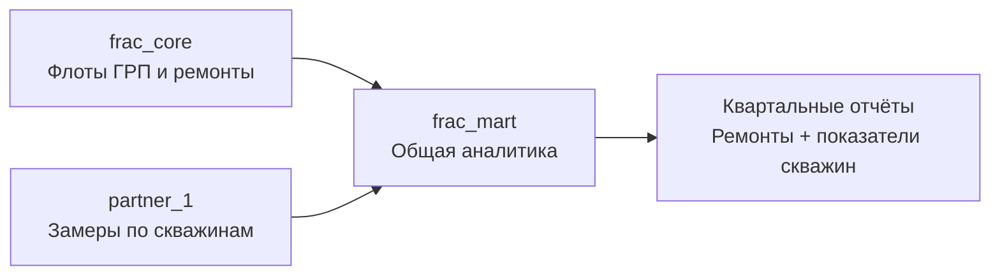

# Проектирование базы данных флотов ГРП для проведения ремонтов на скважинах

<<<<<<< HEAD
Учебный проект на **PostgreSQL 15**. Он охватывает проектирование реляционной БД, нормализацию операционных данных до 3НФ, ограничения целостности, SQL-аналитику, функции PL/pgSQL, индексацию, витрину Кимбалла с SCD Type 2 и интеграцию двух предметных областей.

> **Все данные в репозитории синтетические.** Они созданы для учебной демонстрации и не являются производственными данными или технологическими нормативами ПАО «Газпром нефть».

## 1. Архитектура проекта

В проекте ровно **две исходные предметные области** и один общий аналитический слой:

1. **`frac_core`** — основная БД флотов ГРП, оборудования, ремонтов скважин и технологической телеметрии (12 таблиц).
2. **`partner_1`** — отдельная БД замеров по скважинам (8 таблиц), подготовленная как предметная область одногруппницы.
3. **`frac_mart`** — общая аналитическая схема. Это не третья предметная область и не третий внешний источник: здесь расположены звезда Кимбалла и представления, объединяющие два источника.



Дополнительная архитектурная диаграмма: [`docs/architecture.mmd`](docs/architecture.mmd).

### `frac_core` — основная предметная область

Содержит месторождения, скважины, флоты, типы и единицы оборудования, историю закрепления оборудования за флотами, бригады, виды ремонтов, ремонты, этапы, телеметрию и техническое обслуживание. Каталог 12 сущностей и обоснование границ: [`docs/entity_catalog.md`](docs/entity_catalog.md).

### `partner_1` — замеры по скважинам

Содержит собственные справочники месторождений и скважин, параметры и методики измерений, приборы, операторов, сессии и значения замеров. Полный самостоятельный раздел: [`partner_1/README.md`](partner_1/README.md).

### `frac_mart` — аналитический слой

Классическая звезда Кимбалла: одна таблица фактов `fact_well_repair` и три измерения — `dim_date`, `dim_field` (SCD-2), `dim_repair_type`. Дополнительно созданы три представления для сопоставления скважин и междоменной аналитики.

## 2. Предметная область и проектирование

- Описание предметной области (объект, предмет, цель и процессы): [`docs/domain_description.md`](docs/domain_description.md).
- Пять бизнес-вопросов: [`docs/business_questions.md`](docs/business_questions.md).
- Концептуальная модель (КМД, Mermaid ER): [`docs/conceptual_model.mmd`](docs/conceptual_model.mmd).
- Логическая модель (ЛМД): [`docs/logical_model.md`](docs/logical_model.md), [`docs/logical_model.mmd`](docs/logical_model.mmd).
- Физическая модель (ФМД) PostgreSQL 15: [`docs/physical_model.md`](docs/physical_model.md), [`docs/physical_model.mmd`](docs/physical_model.mmd).
- Каталог сущностей и обоснование состава: [`docs/entity_catalog.md`](docs/entity_catalog.md).
- Нормализация 1НФ → 2НФ → 3НФ и аномалии вставки, обновления, удаления: [`docs/normalization.md`](docs/normalization.md).

Операционные схемы `frac_core` и `partner_1` спроектированы как нормализованные реляционные модели. `frac_mart` намеренно использует размерную модель «звезда»: контролируемая денормализация измерений нужна для аналитических запросов и не заменяет 3НФ операционного контура.

## 3. Реализованные требования преподавателя

| Требование | Реализация |
|---|---|
| Описание предметной области 1–2 стр. и 5 бизнес-вопросов | `docs/domain_description.md`, `docs/business_questions.md` |
| 8–12 сущностей основной предметной области | 12 таблиц `frac_core`; границы описаны в `docs/entity_catalog.md` |
| КМД, ЛМД, ФМД | Mermaid `.mmd` и описания `.md` в `docs/` |
| 3НФ + пример 1НФ → 2НФ → 3НФ с аномалиями | `docs/normalization.md` |
| DDL с PK, FK, CHECK, NOT NULL, типами и комментариями | `ddl/`; для второй предметной области — `partner_1/ddl/` |
| Более 1 000 событий/измерений; справочник около 100 записей | 53 760 строк телеметрии; справочник скважин `frac_core.well` — 100 строк; в `partner_1.source_well` — 100 строк |
| Три индекса разных видов | B-tree, составной частичный B-tree, BRIN — `performance/` |
| EXPLAIN ANALYZE до/после | `docs/indexing_and_explain_analyze.md`, `performance/` |
| Пять сложных запросов | `queries/02`–`06`; есть коррелированный подзапрос, CTE и оконные функции |
| Не менее 10 функций, включая PL/pgSQL с обработкой NULL и деления на 0 | 10 функций в `functions/`; тесты в `functions/02_test_functions.sql` |
| Мини-витрина Кимбалла: факт + 2–3 измерения, одно SCD-2 | `mart/`: `fact_well_repair` + `dim_date`, `dim_field` (SCD-2), `dim_repair_type` |
| Интеграция двух предметных областей и общая аналитика | `integration/`: сопоставление по `field_code + well_code` и междоменные представления |
| README и воспроизводимый запуск | Этот README и `docs/final_run_order.md` |

Подробная трассировка требований: [`docs/requirements_traceability.md`](docs/requirements_traceability.md).

## 4. Структура репозитория

```text
frac-fleet-db/
├── README.md
├── docker-compose.yml
├── .env.example
├── .gitignore
├── ddl/                 # DDL основной схемы frac_core
├── data/                # синтетические данные frac_core
├── functions/           # 10 функций и тестовые вызовы
├── queries/             # бизнес-запросы и проверки frac_core
├── performance/         # индексы, baseline и EXPLAIN ANALYZE
├── mart/                # frac_mart, измерения, факты, SCD-2 и views
├── partner_1/           # самостоятельный проект замеров по скважинам
│   ├── ddl/
│   ├── data/
│   ├── queries/
│   └── docs/
├── integration/         # представления, объединяющие две предметные области
└── docs/                # КМД, ЛМД, ФМД, 3НФ, результаты и инструкции
```

## 5. Требования для запуска

- Docker Engine и Docker Compose;
- PostgreSQL 15;
- DBeaver или другой PostgreSQL-клиент.

### Чистая установка из репозитория

1. Скопируйте `.env.example` в `.env` и задайте собственный локальный пароль.
2. Запустите пустой контейнер PostgreSQL:

```bash
docker compose up -d
```

3. Подключитесь из DBeaver:

| Параметр | Значение по умолчанию |
|---|---|
| Host | `localhost` |
| Port | `5430` |
| Database | `test` |
| User | `postgres` |
| Password | значение `POSTGRES_PASSWORD` из `.env` |

4. Выполняйте SQL-файлы по порядку из [`docs/final_run_order.md`](docs/final_run_order.md). Каждый файл запускайте отдельно и проверяйте результат.

`docker-compose.yml` поднимает только PostgreSQL; SQL-проект применяется вручную по порядку через DBeaver. Это сделано намеренно, чтобы отделить инициализацию контейнера от создания схем и загрузки тестовых данных.

### Использование уже работающего учебного Docker

Если PostgreSQL уже работает на `localhost:5430` и база `test` доступна в DBeaver, не запускайте второй контейнер на том же порту. Используйте существующее подключение. Для исходного учебного контейнера использовались учётные данные `postgres` / `password`.

> Не выполняйте `docker compose down -v`, `DROP DATABASE` и не удаляйте volume существующего учебного контейнера: это удалит данные. В уже развёрнутой БД не запускайте повторно начальные DDL и генераторы данных — используйте контрольные и аналитические запросы.

## 6. Порядок развёртывания

Полная последовательность каждого файла: [`docs/final_run_order.md`](docs/final_run_order.md).

Кратко:

1. Создать `frac_core`: `ddl/01` → `ddl/06`.
2. Загрузить данные `frac_core`: `data/01` → `data/04`.
3. Проверить структуру и данные: `queries/00_check_structure.sql`, `queries/01_verify_generated_data.sql`.
4. Создать и протестировать 10 функций: `functions/01_create_functions.sql`, `functions/02_test_functions.sql`.
5. Выполнить пять бизнес-запросов из `queries/02`–`06`.
6. Создать и загрузить `frac_mart`: `mart/01` → `mart/06`.
7. Создать и заполнить `partner_1`: `partner_1/ddl/01`, `partner_1/data/02`, `partner_1/data/03`; выполнить проверки.
8. Создать представления интеграции: `integration/06_create_cross_domain_views.sql`, затем `integration/07_validation.sql`.
9. Отдельно выполнить эксперимент `performance/`; после baseline обязательно создать индексы обратно через `03_create_target_indexes.sql`.

Если проект уже развёрнут и проверен, повторно выполнять DDL и генераторы не требуется.

## 7. Подтверждённые результаты локального запуска

Результаты фактических проверок пользователя приведены в [`docs/final_results.md`](docs/final_results.md). Ключевые показатели:

- `frac_core`: 12 таблиц; 53 760 телеметрических измерений; 426 ремонтов, из них 420 завершённых.
- `partner_1`: 8 таблиц; 4 300 сессий; 34 400 значений измерений.
- `frac_mart`: 420 строк фактов; 11 версий месторождений в `dim_field`, включая одну историческую версию SCD-2.
- Междоменное сопоставление: 100 скважин по естественному ключу `field_code + well_code`; 0 совпадающих числовых ID у сопоставленных по смыслу пар; наивное соединение только по числовому ID дало 100 неверных пар.
- Междоменная аналитика: все 420 фактов ремонта дополнены подходящей корректной сессией замеров в пределах 90 дней до ремонта; средний интервал — 15,43 дня.
- Индексация: в контрольном запуске времена составили 0,230 → 0,057 мс для B-tree, 0,083 → 0,055 мс для составного частичного B-tree, 3,952 → 0,728 мс для BRIN.

Это результаты конкретного учебного запуска на локальном окружении; они не являются универсальной гарантией производительности.

## 8. Публикация на GitHub

После распаковки проекта в локальную папку:

```bash
git init
git add .
git commit -m "Initial database coursework project"
git branch -M main
git remote add origin https://github.com/<YOUR_USERNAME>/<REPOSITORY_NAME>.git
git push -u origin main
```

Перед `git add .` убедитесь, что `.env`, пароли, дампы и локальные файлы не попадают в коммит. В репозитории должен находиться `.env.example`, но не реальный `.env`.

## 9. Ограничения интерпретации

- Данные обеих исходных предметных областей полностью синтетические.
- Статусы качества измерений, временные ряды и производственные параметры моделируются для демонстрации структуры и SQL.
- `frac_mart` — общий аналитический слой двух источников. В проекте нет третьей предметной области или третьей схемы-компаньона.
- Суммы объёмов жидкости и массы проппанта в фактовой таблице являются агрегатами синтетических ремонтов; это не производственные оценки.
=======
Учебный проект на **PostgreSQL 15**: проектирование реляционной БД, нормализация до 3НФ, ограничения целостности, SQL-аналитика, функции PL/pgSQL, индексация и EXPLAIN ANALYZE, витрина Кимбалла с SCD Type 2, интеграция двух предметных областей.

> **Все данные синтетические.** Они созданы для учебной демонстрации и не являются производственными данными или технологическими нормативами ПАО «Газпром нефть».

## Архитектура

В проекте две исходные предметные области и общий аналитический слой:

1. **`frac_core`** — основная БД флотов ГРП, оборудования, ремонтов скважин и технологической телеметрии (12 таблиц).
2. **`partner_1`** — БД замеров по скважинам (8 таблиц), отдельная предметная область.
3. **`frac_mart`** — общая аналитическая схема, не третья предметная область. Содержит звезду Кимбалла и междоменные представления.

## Что реализовано

- Концептуальная, логическая и физическая модели (КМД, ЛМД, ФМД).
- Нормализация операционных таблиц до 3НФ и пример перехода 1НФ → 2НФ → 3НФ с аномалиями.
- DDL с PK, FK, CHECK, NOT NULL, ограничениями периодов и комментариями.
- Синтетические наборы данных: 53 760 телеметрических измерений в `frac_core`; 4 300 сессий и 34 400 значений измерений в `partner_1`.
- Пять аналитических SQL-запросов, включая коррелированный подзапрос, CTE и оконные функции.
- Десять функций PostgreSQL/PL/pgSQL и тестовые вызовы.
- Три вида индексов: B-tree, составной частичный B-tree и BRIN; планы EXPLAIN ANALYZE до и после.
- Витрина Кимбалла: `fact_well_repair`, `dim_date`, `dim_field` (SCD-2), `dim_repair_type`.
- Интеграция `frac_core` и `partner_1` по естественному ключу `field_code + well_code`.

## Структура проекта

```text
ddl/                 DDL основной схемы frac_core
data/                синтетические данные frac_core
functions/           10 функций и тесты
queries/             аналитические запросы и проверки
performance/         индексы, baseline и EXPLAIN ANALYZE
mart/                аналитическая схема, измерения, факты, SCD-2
partner_1/           самостоятельная БД замеров по скважинам
integration/         междоменные представления и проверки
docs/                описание предметной области, модели, 3НФ и результаты
```

## Запуск

Требования: Docker Engine / Docker Compose, PostgreSQL 15 и DBeaver (или другой PostgreSQL-клиент).

1. Скопируйте `.env.example` в `.env` и задайте локальный пароль.
2. Запустите PostgreSQL командой `docker compose up -d`.
3. Подключитесь к PostgreSQL в DBeaver.
4. Выполняйте SQL-файлы по порядку, указанному в `docs/final_run_order.md`.

**Важно:** `docker-compose.yml` поднимает только PostgreSQL; схемы и данные создаются SQL-скриптами вручную. Если у вас уже работает учебный контейнер на порту 5430 и база `test`, не запускайте второй контейнер на том же порту. Не выполняйте `docker compose down -v` и `DROP DATABASE` для существующего учебного окружения.

## Основные результаты локальной проверки

- `frac_core`: 12 таблиц, 53 760 измерений телеметрии, 426 ремонтов (420 завершённых).
- `partner_1`: 8 таблиц, 4 300 сессий, 34 400 значений измерений.
- `frac_mart`: 420 строк фактов, измерения даты, месторождения (SCD-2) и вида ремонта.
- Междоменное сопоставление: 100 скважин по естественному ключу `field_code + well_code`.
- Индексы проверены через EXPLAIN ANALYZE; результаты конкретного учебного запуска описаны в документации.

## Безопасность

В репозитории должен находиться только шаблон `.env.example`. Не добавляйте настоящий `.env`, пароли, ключи, дампы или персональные данные. Все данные проекта синтетические.

## Ограничения

Модель предназначена для учебного учёта состава флотов, закрепления оборудования, ремонтов и технологических измерений. Она не является промышленной системой управления ГРП и не содержит полного проектирования ГРП (например, детальных рецептур жидкости и графиков закачки).
>>>>>>> 6f948670ee1afa3258ba7083bf9942616c563490
